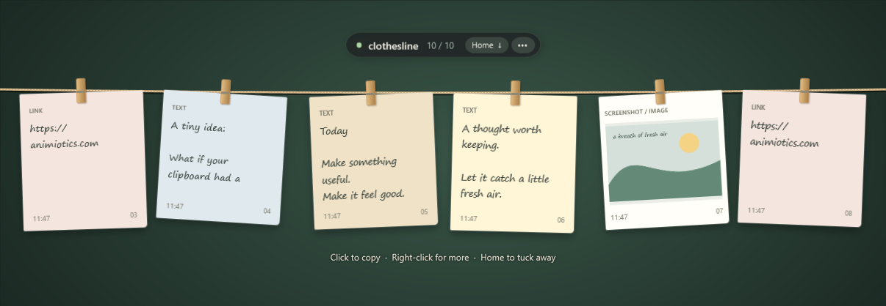

# Clothesline

A tiny clipboard shelf for Windows. Press **Home** and your last 10 copies hang from a clothesline at the top of the screen. Click one to copy it back, then paste it anywhere.



No account, no server, no tracking. Your history stays on your PC, encrypted with your Windows account.

## What it does

- **Text and links** hang as paper notes. Rich formatting (HTML and RTF) is kept when you copy them back.
- **Screenshots and copied images** hang as prints, stored at full resolution. Win+Shift+S works, and new images saved to your Windows Screenshots folder are picked up too.
- **Copied files** are remembered as paths. Clothesline doesn't make backup copies, and putting a file back on the clipboard always copies it, never moves it.
- **Newest on the left.** Copy the same thing twice and it moves to the front instead of taking another slot. Once there are 10, the oldest one drops off.
- **Click a card** to copy it, then press Ctrl+V. The line never steals focus, so you paste straight into the app you were using.
- **Right-click a card** to preview it, copy it as plain text, or take it off the line.

## Install

You need Windows 10 or 11. Nothing else: no runtime to download, no admin rights.

### Option 1: download the app

1. Download `Clothesline.exe` from the [latest release](https://github.com/daniellachev/clothesline/releases/latest).
2. Move it somewhere permanent, for example `%LOCALAPPDATA%\Programs\Clothesline\`.
3. Double-click it. The app isn't code-signed yet, so Windows SmartScreen may say "Windows protected your PC". Click **More info**, then **Run anyway**.
4. Press **Home**.

To start it with Windows, open the **•••** menu on the line (or right-click the tray icon) and tick **Start with Windows**.

### Option 2: build it yourself

If you'd rather not run a downloaded .exe, build it from the source. It uses the C# compiler that already ships with Windows.

```powershell
git clone https://github.com/daniellachev/clothesline.git
cd clothesline
powershell -ExecutionPolicy Bypass -File .\install.ps1
```

`install.ps1` builds the app, installs it to `%LOCALAPPDATA%\Programs\Clothesline`, adds Desktop, Start menu and Startup shortcuts, and starts it. No GitHub account? Download the ZIP from the green **Code** button instead of using `git clone`.

## Shortcuts

| Key | What it does |
| --- | --- |
| **Home** | Show or hide the line |
| **Pause** | Show or hide the line |
| **Ctrl+Alt+Shift+C** | Show or hide the line |

**About the Home key:** while Clothesline runs, Home belongs to it in every app, so it won't jump to the start of a line in your text editor. If you need Home for editing, open the **•••** menu or the tray menu and turn off **Use the Home key**. Pause and Ctrl+Alt+Shift+C keep working, and the setting is remembered.

## Privacy

- History is saved only on your PC, in `%LOCALAPPDATA%\Clothesline\history.bin`, encrypted with your Windows account (DPAPI), so other accounts on the PC can't read it.
- There's no server, no account, no analytics and no network access.
- Copies that an app marks as private (many password managers do this) are never saved.
- You can pause remembering at any time from the **•••** menu or the tray menu.
- The small diagnostics file records which shortcuts registered and how often the line was toggled. It never contains anything you copied.

## Limits

- It keeps the last 10 distinct items.
- Text up to 2 million characters. Images up to 60 megapixels and 32 MB.
- It only sees new copies that reach the clipboard, plus new images in the Screenshots folder. It doesn't import Windows' own clipboard history or your old screenshots.
- App-specific clipboard data that isn't text, an image or files is skipped.

## Uninstall

1. Quit Clothesline from the tray icon.
2. Delete the Clothesline shortcuts from your Desktop, Start menu and Startup folder (press Win+R and type `shell:startup` to open it).
3. Delete `%LOCALAPPDATA%\Programs\Clothesline`.
4. To erase your saved history too, delete `%LOCALAPPDATA%\Clothesline`.

## Build and test

```powershell
.\build.ps1
Start-Process .\bin\Clothesline.exe -ArgumentList '--self-test', "$PWD\self-test.txt" -Wait
Start-Process .\bin\Clothesline.exe -ArgumentList '--integration-test', "$PWD\integration-test.txt" -Wait
Start-Process .\bin\Clothesline.exe -ArgumentList '--demo'
```

- `--self-test` checks retention, duplicates, pause, encryption, rich text, images, removal, settings and corrupt-file handling in a temporary folder.
- `--integration-test` uses the real Windows clipboard and hotkeys. Quit the running app first. It puts your clipboard back the way it was when it finishes.
- `--demo` opens a window with sample cards and records nothing.

| File | What's in it |
| --- | --- |
| `DesktopApp.cs` | The line window, cards, tray icon, shortcuts and screenshot watcher |
| `History.cs` | Encrypted history and reading or writing the clipboard |
| `Tests.cs` | Self-tests, integration tests and demo content |

## License

[MIT](LICENSE)
